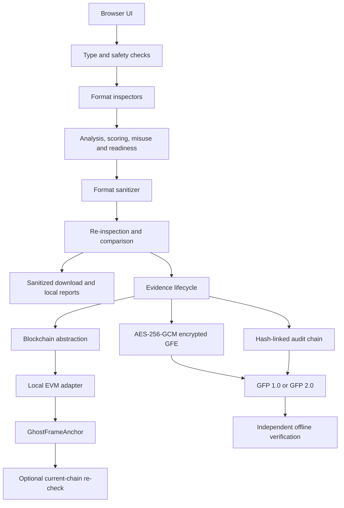

# GhostFrame 2.2.0 Architecture

GhostFrame is a local Streamlit application. Uploaded bytes move only between the browser and the Streamlit process on the same computer. The application has no telemetry, external metadata API, cloud storage, account, or AI-provider integration.



## Components and boundaries

| Layer | Responsibility | Main source |
|---|---|---|
| UI | Upload, explanation, consent-driven actions, downloads | `app.py` |
| Privacy engine | Type validation, limits, optional ExifTool isolation | `ghostframe/security.py` |
| Inspectors | JPG/PNG, PDF and DOCX metadata extraction | `ghostframe/inspectors/` |
| Analysis | Normalization, correlation, scoring, misuse, recommendations | `ghostframe/*.py` |
| Sanitizers | Format-specific safer-copy creation | `ghostframe/sanitizers/` |
| Verification | Re-inspection and before/after comparison | `ghostframe/comparison.py` |
| Evidence | Canonical records, encryption, audit, package and verification | `ghostframe/evidence/` |
| Blockchain | Disabled, in-memory and local-EVM adapters | `ghostframe/blockchain/` |
| Contract | Two-stage commitment registry | `ghostframe/blockchain/contracts/GhostFrameAnchor.sol` |

## Blockchain lifecycle

```text
ORIGINAL FILE -> INSPECTION -> INSPECTION EVIDENCE -> INSPECTION COMMITMENT
  -> LOCAL BLOCKCHAIN ANCHOR #1 -> SANITIZATION -> SANITIZED FILE
  -> RE-INSPECTION -> LOCAL VERIFICATION -> FINAL LIFECYCLE COMMITMENT
  -> LOCAL BLOCKCHAIN ANCHOR #2 -> GFP 2.0 -> INDEPENDENT VERIFICATION
```

Anchor #1 commits to the pre-sanitization inspection before transformation. Anchor #2 is attempted only after local re-inspection and verification. GFP 2.0 records receipts, but offline verification labels them as recorded state, not current chain proof. Current verification requires an independently configured loopback RPC, expected chain ID, contract address, runtime-code hash and interface version.

## Privacy and data placement

**Public on-chain commitments:** operation commitment, source and sanitized file hashes, inspection/schema/verification/lifecycle commitments, submitter address, transaction and block identities, and blockchain timestamps.

**Sensitive off-chain encrypted evidence:** metadata findings, privacy analysis, before/after inspection, sanitization evidence and verification evidence.

**Never intentionally stored on-chain:** plaintext GPS, authors, emails, comments, filenames, document contents, passphrases or encryption keys. File hashes can still enable known-file correlation.

The local EVM is a development demonstration, not a public-chain deployment or production key-management design.
